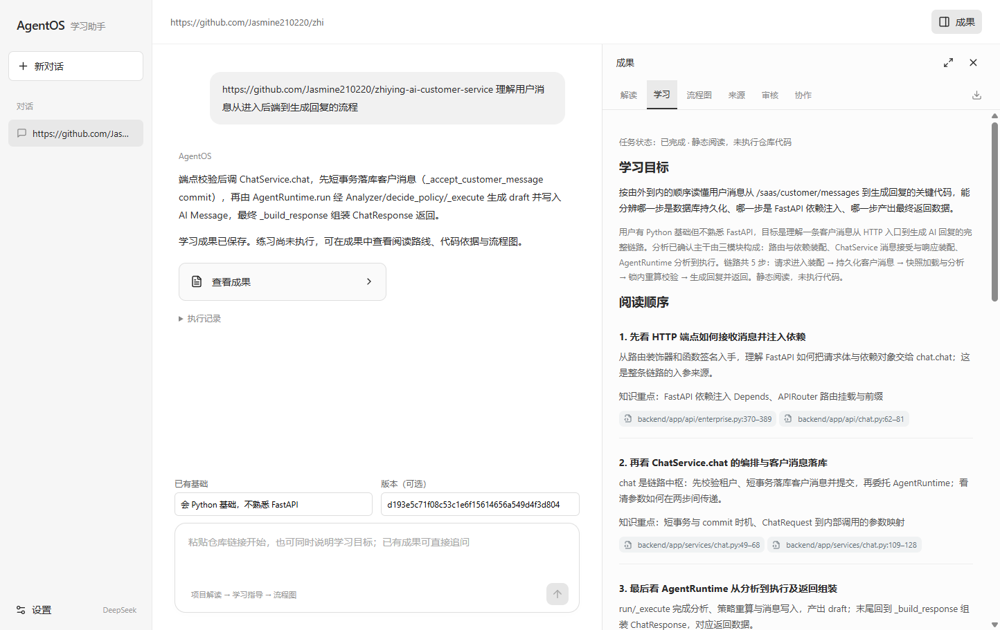
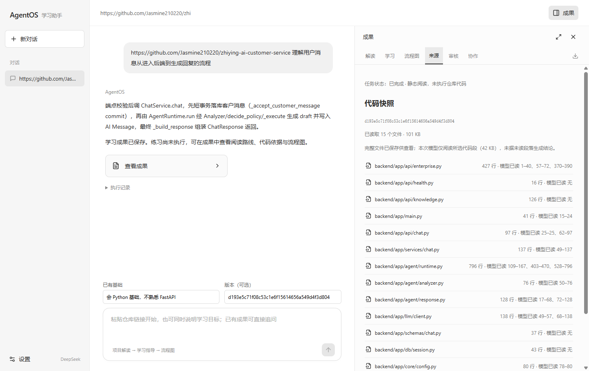
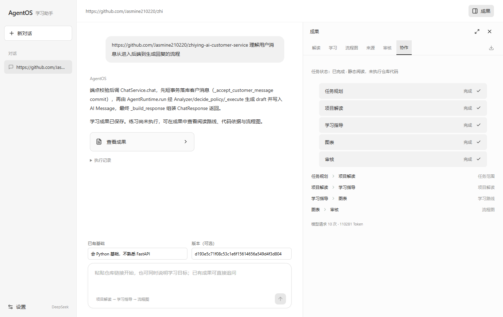
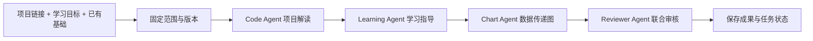

# AgentOS Lite · 多 Agent 项目学习助手

把「这个项目该从哪里读起？」变成一条有源码依据的学习路线。

AgentOS Lite 是面向个人学习与开发的 **Windows 桌面应用**。提供公开 GitHub 项目链接、已有基础和想理解的一条流程，多个角色依次完成项目解读、学习指导、数据传递图生成与审核。中文聊天界面旁是可展开的成果工作区，随时查看代码来源和协作记录。

> **当前状态：0.6.9 开发预览源码。** 已具备真实模型工作流和桌面交互，但内容审核、数据传递图语义和预算稳定性仍有已知问题，尚未达到稳定版验收标准。本仓库不发布未经本轮安装验收的二进制包。

## 使用效果

例如输入：

```text
https://github.com/Jasmine210220/zhiying-ai-customer-service
理解用户消息从进入后端到生成回复的流程。
已有基础：会 Python 基础，不熟悉 FastAPI。
```

可以获得：

- **项目解读**：入口、模块职责和主要流程，附文件与行号。
- **阅读路线**：先看哪些文件、关注哪些知识点，以及三个静态阅读练习。
- **数据传递图**：选定路径中的数据传递，实际渲染为 SVG。
- **来源与协作详情**：代码快照、模型实际阅读范围、角色交接及审核记录。

以下为独立测试数据目录中的真实桌面截图，仅包含上述公开项目的测试会话，不包含个人聊天历史、账号设置或密钥。截图来自整理前的 0.6.5 桌面验收，界面与当前源码基本一致；它们展示交互效果，**不代表截图中的模型结论全部正确**。该次结果在后续人工复核中发现返回对象构建时机等错误，未被当作发布通过证据。

### 聊天与学习成果



### 源码依据与阅读范围

完整文件快照和模型实际读过的区间分别展示，避免把「文件已下载」误解为「全部已分析」。



### 可追溯的角色协作

角色状态、交接和消耗来自真实任务事件；串行工作流也能清楚展示谁接收了什么、产出了什么。



## 功能概览

| 能力 | 当前实现 |
| --- | --- |
| GitHub 链接导入 | 支持公开仓库及可选分支、标签、提交 SHA；仅给链接时先补充学习目标 |
| 有依据的项目解读 | 固定版本快照、文件选择、分段阅读、行号引用校验 |
| 学习指导 | 结合已有基础生成阅读顺序、知识重点及三个练习；练习不自动执行或评分 |
| 数据传递图 | 聚焦一条数据路径，Mermaid 实际渲染，提供 SVG 成果 |
| 协作详情 | 独立角色输入输出、上游成果交接、真实事件及状态 |
| 成果与历史 | 本地保存会话、快照和成果；支持查看来源、导出及重启恢复 |
| 失败反馈 | 读取不足、审核未通过、预算限制、中断均保留已有成果并明确提示 |
| 模型配置 | 设置中配置 DeepSeek；Windows 使用 DPAPI 保护本地保存的密钥 |

当前默认入口聚焦项目学习。仓库保留早期搜索、静态排查、文件副本等实现，但不将它们作为本预览版的主要交付承诺；学习流程不会执行导入仓库的代码，也不自动修复其 Bug。

## 实现思路

### 固定流程，真实协作



这是一条有边界的串行流程，并不依赖角色名称模拟协作：项目解读产出结构化结论和证据；学习角色消费解读结果；绘图角色使用解读与学习成果；审核角色核对这些成果与代码来源。每次交接记录输入摘要、哈希和事件，界面据此更新状态。

### 先约束证据，再核对内容

仓库先解析到确定提交，再读取有限数量和体积的文本文件。大文件按函数和源码区间组织，补充必要调用及返回路径。引用只能落在真实、已读的范围内；学习练习的符号与来源绑定。Python AST 只做静态解析，辅助说明返回值流向和直接副作用归属，不执行目标代码。

来源合法只是第一步。语义审核可能误报或漏报，因此系统保留争议复核、有限局部修正以及失败记录。当前限制为每任务最多 12 次模型调用、120,000 Token 预算和 600 秒；调用前估算与供应商实际计量不同，不构成费用硬上限。

### 本地桌面与成果存储

Electron 启动本地 Python 服务，使用回环地址、随机端口和每次启动的访问令牌。React 界面通过受限桥接访问服务；SQLite 保存会话与任务，文件目录保存快照和成果。Mermaid 在隔离的渲染流程中实际生成 SVG，渲染失败不能被标成绘图成功。

## 技术栈

| 层次 | 技术 |
| --- | --- |
| 桌面壳与安装 | Electron、electron-builder、NSIS |
| 界面 | React、TypeScript、Vite、Lucide |
| 后端与数据约束 | Python、FastAPI、Pydantic、HTTPX |
| 工作流 | LangGraph 与固定角色流程、结构化模型输出 |
| 模型 | DeepSeek API，默认 `deepseek-flash`，可在设置中配置 |
| 图与持久化 | Mermaid / SVG、SQLite、本地文件快照 |
| 测试与打包 | pytest、Playwright、PyInstaller |

## 项目结构

```text
backend/
  learning.py             学习流程、角色执行与预算边界
  learning_reading.py     分段阅读与来源编号
  learning_review.py      内容审核、争议复核与局部修正
  learning_exercises.py   练习结构及来源绑定
  learning_diagram.py     图约束与校验
  llm.py                  模型协议、调用计量与源码上下文
  github.py               仓库读取
  store.py                本地任务与事件保存
src/                      聊天、成果工作区、设置与协作展示
electron/                 桌面生命周期、受限桥接和图渲染
tests/                    后端回归与桌面集成脚本
scripts/                  构建和显式真实模型验收工具
docs/                     截图与版本质量说明
```

## 本地运行

开发环境：Windows、Python 3.11+、Node.js 22+。模型调用需要自己的 DeepSeek API Key，可能产生费用。

```powershell
git clone https://github.com/Jasmine210220/agentos-learning-assistant.git
cd agentos-learning-assistant
python -m venv .venv
.\.venv\Scripts\python.exe -m pip install -r requirements-lock.txt
npm ci
npm run build
.\Start-AgentOS.cmd
```

启动后在设置中配置模型密钥。也可在当前终端设置 `DEEPSEEK_API_KEY` 后启动；不要把真实密钥写入源码或提交到 Git。应用数据默认保存到 `%APPDATA%/agentos-lite/data`，可以用 `AGENTOS_DATA_DIR` 指向独立测试目录。

提供链接、明确目标与已有基础后提交任务；等待角色完成，查看解读、学习、数据传递图、来源和审核。若状态为「需关注」，先阅读失败原因，已有成果不等于已通过审核。

## 测试与 Windows 构建

```powershell
.\.venv\Scripts\python.exe -m pip install -r requirements-dev.txt
.\.venv\Scripts\python.exe -m pytest -q
npm run build
npm run dist
```

构建脚本先打包后端与前端，再生成 NSIS 安装包，并核对构建期间源码没有变化。当前输出目录为 `release-v0.6.9`。**构建成功不等于安装可用**：还需在 Windows 上验证安装、启动、模型配置、完整任务、退出、历史恢复和卸载。

真实模型验收需主动运行相应脚本，并使用自己的配置；常规 pytest 通过不能证明模型生成内容正确。部分桌面测试需要先构建可执行文件，历史专项脚本需要各自的测试夹具。

## 当前质量与边界

本轮自动回归、审核校准、真实任务和 Windows 安装结果分别记录在 [收尾验收记录](docs/FINISHING-ACCEPTANCE.md)；不以模型任务成功状态代替内容验收。客服项目专项测试也发现了「系统成功、人工不通过」的结果：引用区间合法但支撑不足、图的数据依赖错误、已读范围说明矛盾，以及重试挤占审核预算。

因此当前适合作为多 Agent 学习助手的开发预览与实现展示，重要结论仍应回到源码确认。详见 [版本质量说明](docs/STATUS.md)。原始私人工作区日志、数据库、个人设置、安装产物与历史聊天均不随源码公开。

## 本轮收尾验收

主界面常驻协作区来自实际任务事件，终态显示历史记录；自动审核区分未发现问题、争议未解决和已确认错误修正复核。当前只支持数据传递图，明确要求调用顺序或执行时序的任务会说明边界并停止，不静默替换图种。

固定公开夹具及复现步骤见 [收尾验收](docs/FINISHING-ACCEPTANCE.md)。
